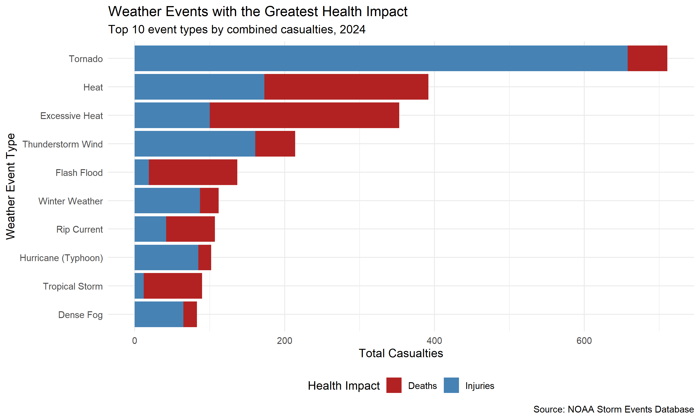
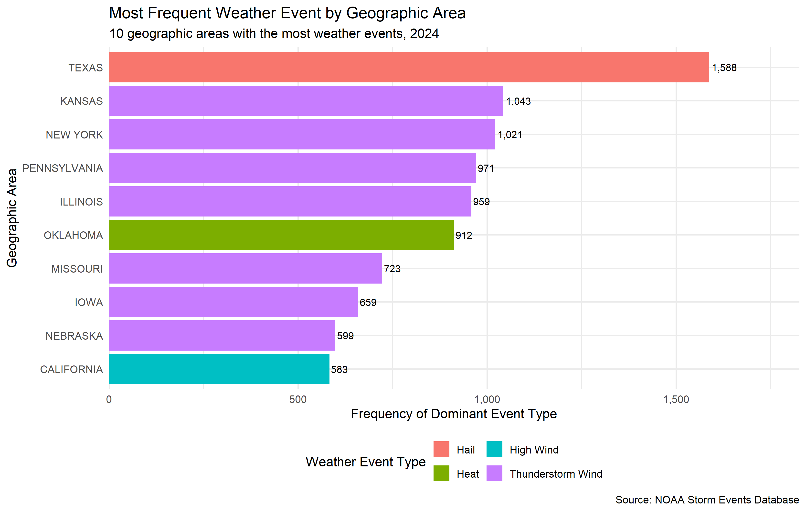
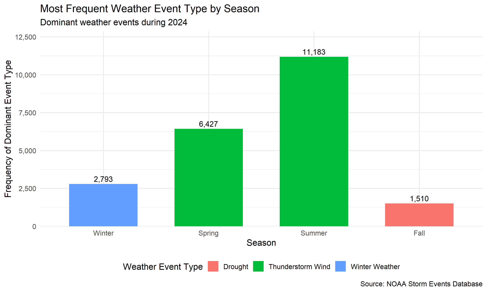
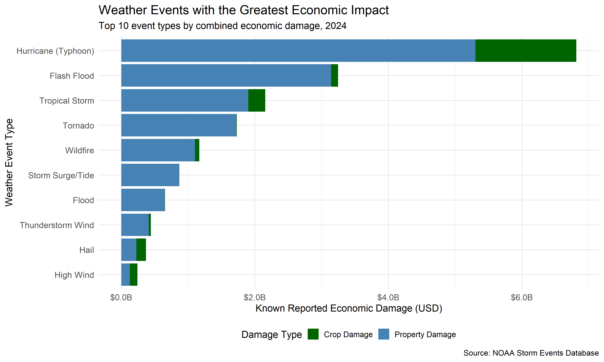
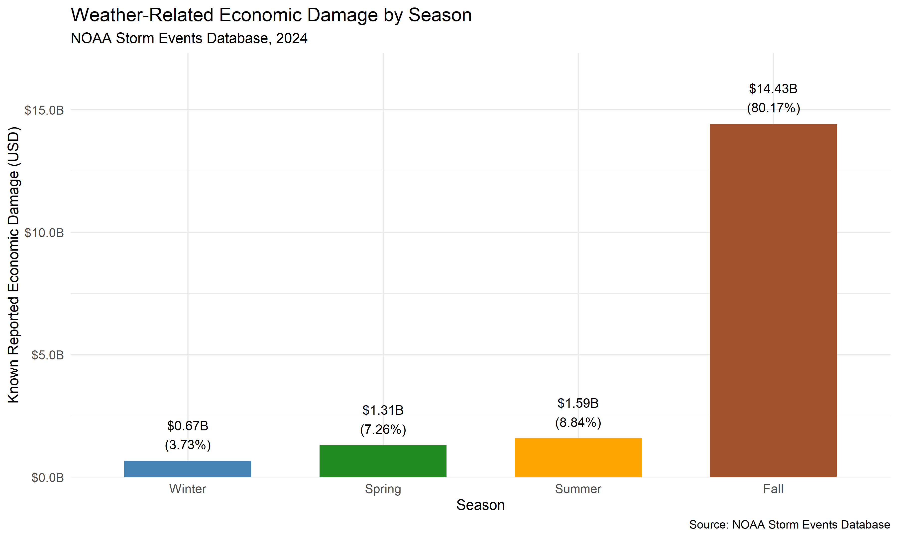

```{r setup, include=FALSE}
knitr::opts_chunk$set(
  echo = TRUE,
  warning = FALSE,
  message = FALSE,
  fig.width = 10,
  fig.height = 6,
  fig.align = "center"
)
```
## Synopsis

This study examines the frequency, geographic distribution, population health impacts, and economic consequences of severe weather events recorded in the National Oceanic and Atmospheric Administration (NOAA) Storm Events Database during 2024. Three datasets containing weather event details, fatalities, and geographic locations were integrated and processed using R. The final analytical dataset contained 69,802 weather event records, representing 50 event types across 68 geographic areas. Thunderstorm wind was the most frequently recorded weather event, while excessive heat caused the greatest number of deaths and tornadoes caused the greatest number of injuries. Texas recorded the highest frequency of weather events, while May was the most active month and summer was the most active season. Hurricanes and typhoons generated the greatest combined economic damage, with Florida experiencing the highest reported economic losses. Total known reported property and crop damage amounted to approximately $18 billion, with 80.17% occurring during the fall season. These findings highlight the importance of geographic and seasonal considerations in disaster preparedness, public health protection, and economic risk management. The analysis also acknowledges limitations associated with incomplete damage information, discrepancies in fatality reporting, and the use of a single year of weather data.

## Data Processing

### Data Source

The data used in this research were obtained from the National Oceanic and Atmospheric Administration (NOAA) National Centers for Environmental Information (NCEI) Storm Events Database.

The analysis focuses on weather events recorded during the 2024 calendar year and incorporates three datasets:

- Storm Events Details: Contains event classifications, geographic information, deaths, injuries, property damage, and crop damage.
- Storm Events Fatalities: Contains individual fatality records associated with weather events.
- Storm Events Locations: Contains geographic location records associated with weather events.

The original datasets are available at:

https://www.ncei.noaa.gov/pub/data/swdi/stormevents/csvfiles/

### Reproducible Analysis

The original datasets were imported, validated, integrated, cleaned, and analyzed using R. The complete analytical workflow is maintained in the accompanying Final_Project.R script.

```{r execute-analysis, echo=TRUE, results='hide', fig.keep='none'}
source("Final_Project.R", local = knitr::knit_global())
```

### Data Integration

The three datasets were integrated using EVENT_ID as the common identifier. Fatality and location records were aggregated before integration to prevent one-to-many relationships from creating duplicate weather event records.

Validation checks were performed to confirm that the original number of weather events was preserved and that the integrated dataset contained unique event identifiers.

```{r integration-validation}
stopifnot(
  nrow(storm_data) == nrow(details),
  !anyDuplicated(storm_data$EVENT_ID),
  sum(storm_data$FATALITY_RECORDS) == nrow(fatalities),
  sum(storm_data$LOCATION_RECORDS) == nrow(locations)
)

knitr::kable(
  data.frame(
    Dataset = c(
      "Storm Events Details",
      "Storm Events Fatalities",
      "Storm Events Locations",
      "Integrated Dataset"
    ),
    Records = c(
      nrow(details),
      nrow(fatalities),
      nrow(locations),
      nrow(storm_data)
    )
  ),
  caption = "NOAA dataset integration summary",
  format.args = list(big.mark = ",")
)
```

### Data Cleaning and Transformation

The integrated dataset was cleaned and transformed to support the four research questions.

The following transformations were performed:

- Standardized geographic area and weather event names.
- Combined direct and indirect deaths.
- Combined direct and indirect injuries.
- Calculated total casualties.
- Converted abbreviated property and crop damage values into numeric US dollar amounts.
- Identified records containing incomplete economic damage information.
- Organized months chronologically and classified events by season.

NOAA economic damage values use suffixes to represent thousands (K), millions (M), and billions (B). These values were converted into numeric dollar amounts using a custom R function.

```{r damage-conversion}
convert_damage

data.frame(
  Original_Value = c("25K", "2.5M", "1.2B"),
  Converted_Value = convert_damage(
    c("25K", "2.5M", "1.2B")
  )
)
```

### Missing Data and Data Quality

Missing or unrecognized economic damage values were retained as missing values in the individual property and crop damage variables.

Combined economic damage was calculated using available reported amounts. Therefore, economic totals presented in this report represent known reported damage rather than a comprehensive estimate of all economic losses.

```{r data-quality}
quality_summary <- data.frame(
  Metric = c(
    "Total weather event records",
    "Unique event identifiers",
    "Weather event types",
    "Geographic areas",
    "Records with incomplete damage information",
    "Percentage with incomplete damage information"
  ),
  Value = c(
    format(nrow(storm_clean), big.mark = ","),
    format(
      dplyr::n_distinct(storm_clean$EVENT_ID),
      big.mark = ","
    ),
    dplyr::n_distinct(storm_clean$EVENT_TYPE),
    dplyr::n_distinct(storm_clean$STATE),
    format(
      sum(storm_clean$DAMAGE_INCOMPLETE),
      big.mark = ","
    ),
    paste0(
      round(
        mean(storm_clean$DAMAGE_INCOMPLETE) * 100,
        2
      ),
      "%"
    )
  )
)

knitr::kable(
  quality_summary,
  caption = "Final analytical dataset quality summary"
)
```

### Data Processing Validation

The final analytical dataset was validated to confirm that all original weather event records were preserved throughout the integration and transformation process.

```{r final-data-validation}
stopifnot(
  nrow(storm_clean) == nrow(details),
  !anyDuplicated(storm_clean$EVENT_ID),
  !anyNA(storm_clean$MONTH_NAME),
  !anyNA(storm_clean$SEASON)
)

cat("Data processing validation: PASS")
```

## Results

### Research Question 1: Population Health

**Which types of weather events are most harmful to population health?**

Population health impacts were evaluated using the total number of direct and indirect deaths and injuries associated with each weather event type.

Weather events were ranked separately by fatalities, injuries, and combined casualties to identify the event types that presented the greatest threat to population health during 2024.

```{r health-summary}
health_results <- data.frame(
  Measurement = c(
    "Leading cause of deaths",
    "Leading cause of injuries",
    "Greatest combined health impact"
  ),
  Weather_Event = c(
    top_deaths$EVENT_TYPE[1],
    top_injuries$EVENT_TYPE[1],
    top_casualties$EVENT_TYPE[1]
  ),
  Total = c(
    top_deaths$TOTAL_DEATHS[1],
    top_injuries$TOTAL_INJURIES[1],
    top_casualties$TOTAL_CASUALTIES[1]
  )
)

knitr::kable(
  health_results,
  caption = "Leading weather events by population health impact",
  format.args = list(big.mark = ",")
)
```

```{r figure-health-impact, echo=FALSE, out.width="100%", fig.cap="Figure 1. Top 10 weather event types by combined population health impact in 2024."}

```

The results indicate that `r top_deaths$EVENT_TYPE[1]` was the leading cause of weather-related fatalities, accounting for `r scales::comma(top_deaths$TOTAL_DEATHS[1])` reported deaths.

The leading cause of weather-related injuries was `r top_injuries$EVENT_TYPE[1]`, accounting for `r scales::comma(top_injuries$TOTAL_INJURIES[1])` reported injuries.

When deaths and injuries were combined, `r top_casualties$EVENT_TYPE[1]` had the greatest overall population health impact, with `r scales::comma(top_casualties$TOTAL_CASUALTIES[1])` reported casualties.

This event type accounted for approximately `r round(top_casualties$TOTAL_CASUALTIES[1] / sum(storm_clean$TOTAL_CASUALTIES) * 100, 2)`% of all reported weather-related casualties during 2024.

These findings demonstrate the importance of evaluating both fatalities and injuries when assessing the public health consequences of severe weather. An event type that causes the most fatalities does not necessarily cause the most injuries.

The results may help emergency management agencies and public health officials identify priority areas for preparedness, public awareness, and risk mitigation.

### Research Question 2: Geographic Analysis

**How are weather events distributed geographically, and which weather event types are most frequent across geographic areas?**

Weather events were grouped by geographic area and event type to identify differences in event frequency and population health impacts across the United States and other geographic areas represented in the NOAA database.

The analysis identified the geographic areas with the highest number of weather events, fatalities, injuries, and combined casualties.

```{r geographic-summary}
geographic_results <- data.frame(
  Measurement = c(
    "Highest weather event frequency",
    "Most weather-related deaths",
    "Most weather-related injuries",
    "Greatest combined health impact"
  ),
  Geographic_Area = c(
    top_state_events$STATE[1],
    top_state_deaths$STATE[1],
    top_state_injuries$STATE[1],
    top_state_casualties$STATE[1]
  ),
  Total = c(
    top_state_events$TOTAL_EVENTS[1],
    top_state_deaths$TOTAL_DEATHS[1],
    top_state_injuries$TOTAL_INJURIES[1],
    top_state_casualties$TOTAL_CASUALTIES[1]
  )
)

knitr::kable(
  geographic_results,
  caption = "Leading geographic areas by weather event frequency and population health impact",
  format.args = list(big.mark = ",")
)
```

#### Dominant Weather Events by Geographic Area

The most frequently recorded weather event type was identified for each geographic area. The following table presents the dominant weather event types within the ten geographic areas with the highest overall weather event frequency.

```{r dominant-geographic-summary}
knitr::kable(
  top_dominant_events %>%
    select(
      STATE,
      EVENT_TYPE,
      TOTAL_EVENTS
    ),
  col.names = c(
    "Geographic Area",
    "Dominant Weather Event",
    "Event Frequency"
  ),
  caption = "Most frequent weather event types in the ten most active geographic areas",
  format.args = list(big.mark = ",")
)
```

```{r figure-geographic-impact, echo=FALSE, out.width="100%", fig.cap="Figure 2. Most frequent weather event type within the ten geographic areas with the highest overall event frequency in 2024."}

```

#### Interpretation of Geographic Results

The analysis identified `r nrow(state_summary)` geographic areas represented in the 2024 NOAA Storm Events Database.

`r tools::toTitleCase(tolower(top_state_events$STATE[1]))` recorded the highest number of weather events, with `r scales::comma(top_state_events$TOTAL_EVENTS[1])` reported events. This represented approximately `r round(top_state_events$TOTAL_EVENTS[1] / sum(state_summary$TOTAL_EVENTS) * 100, 2)`% of all recorded weather events.

The highest number of weather-related fatalities occurred in `r tools::toTitleCase(tolower(top_state_deaths$STATE[1]))`, with `r scales::comma(top_state_deaths$TOTAL_DEATHS[1])` reported deaths.

The highest number of weather-related injuries occurred in `r tools::toTitleCase(tolower(top_state_injuries$STATE[1]))`, with `r scales::comma(top_state_injuries$TOTAL_INJURIES[1])` reported injuries.

The geographic area experiencing the greatest combined population health impact was `r tools::toTitleCase(tolower(top_state_casualties$STATE[1]))`, with `r scales::comma(top_state_casualties$TOTAL_CASUALTIES[1])` reported casualties.

The results demonstrate that weather event frequency and population health impacts vary across geographic areas. Areas experiencing the greatest number of weather events do not necessarily experience the greatest number of fatalities.

These findings highlight the importance of geographically targeted emergency preparedness and disaster risk mitigation strategies. However, the results represent absolute event and casualty counts rather than population-adjusted risk estimates.

### Research Question 3: Temporal Analysis

**How do weather event frequency and population health impacts vary by month and season?**

Weather events were grouped by month and season to identify temporal patterns in event frequency, fatalities, injuries, and combined casualties.

The seasons were classified as winter (December through February), spring (March through May), summer (June through August), and fall (September through November).

#### Monthly Weather Event Patterns

```{r monthly-weather-summary}
knitr::kable(
  monthly_summary,
  col.names = c(
    "Month",
    "Total Events",
    "Deaths",
    "Injuries",
    "Casualties"
  ),
  caption = "Monthly weather event frequency and population health impacts",
  format.args = list(big.mark = ",")
)
```

#### Seasonal Weather Event Patterns

```{r seasonal-weather-summary}
knitr::kable(
  seasonal_summary,
  col.names = c(
    "Season",
    "Total Events",
    "Deaths",
    "Injuries",
    "Casualties",
    "Event Percentage (%)"
  ),
  caption = "Seasonal weather event frequency and population health impacts",
  format.args = list(big.mark = ",")
)
```

#### Dominant Weather Events by Season

The most frequently recorded weather event type was identified for each season to determine how dominant weather hazards changed throughout the year.

```{r dominant-seasonal-summary}
knitr::kable(
  dominant_seasonal_events %>%
    select(
      SEASON,
      EVENT_TYPE,
      TOTAL_EVENTS
    ),
  col.names = c(
    "Season",
    "Dominant Weather Event",
    "Event Frequency"
  ),
  caption = "Most frequently recorded weather event types by season",
  format.args = list(big.mark = ",")
)
```

```{r figure-temporal-patterns, echo=FALSE, out.width="100%", fig.cap="Figure 3. Most frequently recorded weather event types by season in 2024."}

```

#### Interpretation of Temporal Results

```{r temporal-leaders}
peak_event_month <- monthly_summary %>%
  slice_max(TOTAL_EVENTS, n = 1, with_ties = FALSE)

peak_death_month <- monthly_summary %>%
  slice_max(TOTAL_DEATHS, n = 1, with_ties = FALSE)

peak_injury_month <- monthly_summary %>%
  slice_max(TOTAL_INJURIES, n = 1, with_ties = FALSE)

peak_event_season <- seasonal_summary %>%
  slice_max(TOTAL_EVENTS, n = 1, with_ties = FALSE)

peak_health_season <- seasonal_summary %>%
  slice_max(TOTAL_CASUALTIES, n = 1, with_ties = FALSE)
```

The month with the highest weather event frequency was `r as.character(peak_event_month$MONTH_NAME)`, with `r scales::comma(peak_event_month$TOTAL_EVENTS)` recorded events.

The highest number of weather-related fatalities occurred in `r as.character(peak_death_month$MONTH_NAME)`, with `r scales::comma(peak_death_month$TOTAL_DEATHS)` reported deaths.

The highest number of weather-related injuries occurred in `r as.character(peak_injury_month$MONTH_NAME)`, with `r scales::comma(peak_injury_month$TOTAL_INJURIES)` reported injuries.

At the seasonal level, `r as.character(peak_event_season$SEASON)` experienced the greatest weather event frequency, with `r scales::comma(peak_event_season$TOTAL_EVENTS)` recorded events, representing approximately `r peak_event_season$EVENT_PERCENTAGE`% of all weather events during 2024.

The season experiencing the greatest combined population health impact was `r as.character(peak_health_season$SEASON)`, with `r scales::comma(peak_health_season$TOTAL_CASUALTIES)` reported casualties.

Thunderstorm wind was the dominant weather event type during both spring and summer, while winter weather dominated during winter and drought dominated during fall.

These findings demonstrate that weather event frequency, event classifications, and population health consequences vary throughout the year.

Seasonal differences may assist emergency management agencies in allocating resources, developing public awareness campaigns, and preparing for periods of increased weather-related risk.

However, because this analysis examines only one calendar year, the observed temporal patterns should not be interpreted as evidence of long-term climate trends.

### Research Question 4: Economic Consequences

**Which types of weather events have the greatest economic consequences, and how do economic impacts vary geographically and seasonally?**

Economic consequences were evaluated using reported property damage and crop damage. Both measurements were converted into numeric US dollar amounts and combined to calculate known reported economic damage.

#### Overall Economic Impact

```{r economic-overall-summary}
economic_totals <- data.frame(
  Damage_Type = c(
    "Property Damage",
    "Crop Damage",
    "Combined Economic Damage"
  ),
  Total_USD = c(
    sum(storm_clean$PROPERTY_DAMAGE_USD, na.rm = TRUE),
    sum(storm_clean$CROP_DAMAGE_USD, na.rm = TRUE),
    sum(storm_clean$TOTAL_DAMAGE_USD, na.rm = TRUE)
  )
)

knitr::kable(
  economic_totals %>%
    mutate(
      Total_USD = scales::dollar(
        Total_USD,
        accuracy = 1
      )
    ),
  col.names = c(
    "Damage Type",
    "Known Reported Damage"
  ),
  caption = "Total reported economic damage during 2024"
)
```

#### Economic Damage by Weather Event Type

Weather event types were ranked according to their reported property damage, crop damage, and combined economic damage.

```{r economic-event-summary}
knitr::kable(
  top_total_damage %>%
    select(
      EVENT_TYPE,
      PROPERTY_DAMAGE,
      CROP_DAMAGE,
      TOTAL_DAMAGE
    ) %>%
    mutate(
      across(
        c(
          PROPERTY_DAMAGE,
          CROP_DAMAGE,
          TOTAL_DAMAGE
        ),
        ~ scales::dollar(.x, accuracy = 1)
      )
    ),
  col.names = c(
    "Weather Event",
    "Property Damage",
    "Crop Damage",
    "Combined Damage"
  ),
  caption = "Top 10 weather event types by combined economic damage"
)
```

```{r figure-economic-impact, echo=FALSE, out.width="100%", fig.cap="Figure 4. Weather event types with the greatest combined economic damage during 2024."}

```

#### Geographic Economic Consequences

```{r geographic-economic-summary}
knitr::kable(
  economic_by_state %>%
    slice_max(
      TOTAL_DAMAGE,
      n = 10,
      with_ties = FALSE
    ) %>%
    select(
      STATE,
      TOTAL_DAMAGE
    ) %>%
    mutate(
      TOTAL_DAMAGE = scales::dollar(
        TOTAL_DAMAGE,
        accuracy = 1
      )
    ),
  col.names = c(
    "Geographic Area",
    "Combined Economic Damage"
  ),
  caption = "Top 10 geographic areas by reported economic damage"
)
```

#### Seasonal Economic Consequences

```{r seasonal-economic-summary}
seasonal_damage_results <- economic_by_season %>%
  mutate(
    DAMAGE_PERCENTAGE =
      TOTAL_DAMAGE / sum(TOTAL_DAMAGE) * 100
  )

knitr::kable(
  seasonal_damage_results %>%
    select(
      SEASON,
      TOTAL_DAMAGE,
      DAMAGE_PERCENTAGE
    ) %>%
    mutate(
      TOTAL_DAMAGE = scales::dollar(
        TOTAL_DAMAGE,
        accuracy = 1
      ),
      DAMAGE_PERCENTAGE = round(
        DAMAGE_PERCENTAGE,
        2
      )
    ),
  col.names = c(
    "Season",
    "Combined Economic Damage",
    "Percentage of Total Damage (%)"
  ),
  caption = "Distribution of reported economic damage by season"
)
```

```{r figure-seasonal-economic-impact, echo=FALSE, out.width="100%", fig.cap="Figure 5. Seasonal distribution of known reported economic damage during 2024."}

```

#### Interpretation of Economic Results

```{r economic-leaders}
peak_property_event <- economic_by_event %>%
  slice_max(
    PROPERTY_DAMAGE,
    n = 1,
    with_ties = FALSE
  )

peak_crop_event <- economic_by_event %>%
  slice_max(
    CROP_DAMAGE,
    n = 1,
    with_ties = FALSE
  )

peak_economic_event <- economic_by_event %>%
  slice_max(
    TOTAL_DAMAGE,
    n = 1,
    with_ties = FALSE
  )

peak_economic_state <- economic_by_state %>%
  slice_max(
    TOTAL_DAMAGE,
    n = 1,
    with_ties = FALSE
  )

peak_economic_month <- economic_by_month %>%
  slice_max(
    TOTAL_DAMAGE,
    n = 1,
    with_ties = FALSE
  )

peak_economic_season <- seasonal_damage_results %>%
  slice_max(
    TOTAL_DAMAGE,
    n = 1,
    with_ties = FALSE
  )
```

The total known reported economic damage associated with weather events during 2024 was approximately `r scales::dollar(sum(storm_clean$TOTAL_DAMAGE_USD) / 1e9, accuracy = 0.01)` billion.

The weather event type responsible for the greatest property damage was `r peak_property_event$EVENT_TYPE`, generating approximately `r scales::dollar(peak_property_event$PROPERTY_DAMAGE / 1e9, accuracy = 0.01)` billion in reported property damage.

The greatest crop damage was associated with `r peak_crop_event$EVENT_TYPE`, generating approximately `r scales::dollar(peak_crop_event$CROP_DAMAGE / 1e9, accuracy = 0.01)` billion in reported agricultural losses.

When property and crop damage were combined, `r peak_economic_event$EVENT_TYPE` generated the greatest economic impact, accounting for approximately `r scales::dollar(peak_economic_event$TOTAL_DAMAGE / 1e9, accuracy = 0.01)` billion in reported damage.

Geographically, `r tools::toTitleCase(tolower(peak_economic_state$STATE))` experienced the greatest reported economic damage, totaling approximately `r scales::dollar(peak_economic_state$TOTAL_DAMAGE / 1e9, accuracy = 0.01)` billion.

The month with the greatest economic damage was `r peak_economic_month$MONTH`, with approximately `r scales::dollar(peak_economic_month$TOTAL_DAMAGE / 1e9, accuracy = 0.01)` billion in reported losses.

The season experiencing the greatest economic consequences was `r as.character(peak_economic_season$SEASON)`, accounting for approximately `r round(peak_economic_season$DAMAGE_PERCENTAGE, 2)`% of all known reported economic damage.

These findings demonstrate that the most frequently recorded weather events are not necessarily those responsible for the greatest economic losses.

The concentration of economic damage during specific periods highlights the importance of seasonal disaster preparedness, infrastructure resilience, insurance planning, and financial risk management.

Economic damage estimates should be interpreted with caution because some weather event records contain incomplete property or crop damage information.

## Appendix: Complete R Analysis Code

The following appendix contains the complete R source code used to import, integrate, clean, validate, analyze, and visualize the 2024 NOAA Storm Events datasets.

```{r complete-analysis-code, echo=FALSE, results='asis'}
cat("```r\n")
cat(readLines("Final_Project.R", warn = FALSE), sep = "\n")
cat("\n```\n")
```
